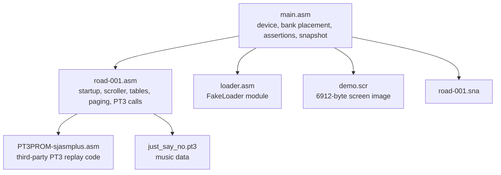
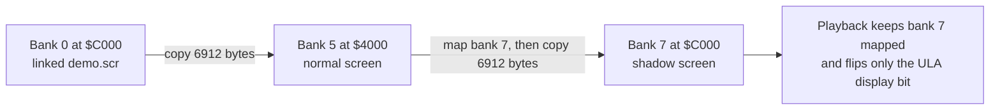
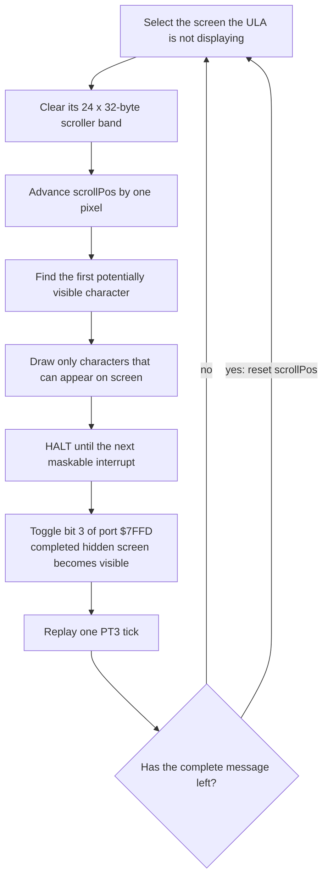

# ROAD-001 : ZX Spectrum 128K sine-scroller demo

https://youtu.be/oSsJlL5o9Cw

A ZX Spectrum demo and Z80 assembly learning project. The current demo targets
the 128K Spectrum and combines:

- a static full-screen `.scr` image;
- a smooth, double-buffered sine-wave text scroller;
- fixed red, yellow and blue colour bands behind the scroller; and
- PT3 music played through the 128K AY sound chip.

The core effect was first developed for the 48K Spectrum. That working version
is retained separately, while the active 128K version uses the extra RAM for
hardware screen flipping and AY music. A Spectrum Next version may follow
later, but this demo deliberately uses standard 128K hardware.

## Current status

The active demo is working in ZXSpin's 128K mode. Earlier rendering stages were
also checked in Fuse.

The renderer builds each frame on the hidden hardware screen and flips it into
view only when complete. The current message and PT3 replay remain within one
50 Hz frame in emulator testing. Border profiling is normally disabled.

Before the main presentation, a reusable fake cassette loader reproduces a
short ROM-style loading sequence and reports the demo's internal project name.

## Requirements

- SjASMPlus on `PATH` (currently tested with version 1.24.0)
- a ZX Spectrum 128K emulator; ZXSpin 0.7 is the primary development emulator

CSpect is intended primarily for the eventual Spectrum Next phase.

Current Fuse releases automatically interpret 128K `.sna` files as Pentagon
snapshots because the format has no machine-identification field. Consequently
this snapshot is not a reliable standard-128K test in Fuse unless that emulator
behaviour changes. Selecting 128K manually does not override it.

## Build and run

Run:

```text
build.bat
```

This assembles `main.asm` and creates `road-001.sna`. Open that snapshot in
ZXSpin configured as a ZX Spectrum 128K; it starts the demo automatically.

The former 48K build and standalone experiments are retained in
`archive_artifacts/`, but they are not part of the active build workflow.

## How the project is assembled

`main.asm` is deliberately small. It selects the 128K virtual device, includes
the active components, places the screen asset in RAM bank 0 and asks
SjASMPlus to write the snapshot.



The assembler's `DEVICE ZXSPECTRUM128` mode is important: this is not a flat
64K binary. SjASMPlus maintains the contents of all eight 16K RAM banks, and
`MMU` selects which bank receives data assembled at `$C000`. `SAVESNA` then
packages that machine state into the final snapshot.

## Memory map

The 128K Spectrum still gives the Z80 a 64K address space. The bottom 48K has a
mostly fixed purpose, while `$C000-$FFFF` is a window onto one of eight RAM
banks. During normal playback ROAD-001 keeps bank 7 in that window and uses it
as the shadow screen.

The addresses below are from the current build. Message, code and module edits
can move labels inside bank 2, so the assembly-time assertions are the final
authority.

```mermaid
flowchart TB
    subgraph CPU["Z80 address space during normal playback"]
        direction TB
        ROM["$0000-$3FFF<br/>48K BASIC ROM<br/>font source at $3D00"]
        B5["$4000-$7FFF : RAM bank 5<br/>$4000-$57FF normal-screen bitmap<br/>$5800-$5AFF attributes"]
        B2A["$8000-$8008 : RAM bank 2<br/>entry jump and mutable state"]
        B2B["$8009-$825C<br/>zero-terminated scroll message<br/>595 characters in this build"]
        B2C["$825D-$85A9<br/>startup, frame loop and renderer code"]
        B2D["$85AA-$88A9<br/>768-byte thickened ROM font"]
        B2E["$88AA-$88E9 plus alignment padding<br/>64-byte source sine table"]
        B2F["$8900-$A7FF<br/>7936-byte pre-shifted font"]
        B2G["$A800-$A87F<br/>64 precomputed screen offsets"]
        B2H["$A880-$B123<br/>PT3 player code and state"]
        B2I["$B124-$B57B<br/>embedded PT3 module"]
        B2J["$B57C-$B6AF<br/>fake-loader code and data"]
        B2K["$B6B0-$BBFE<br/>free/headroom in this build"]
        ST["$BBFF-$BFFF<br/>minimum reserved stack region<br/>SP starts at $BFFF and grows down"]
        B7["$C000-$FFFF : RAM bank 7<br/>$C000-$D7FF shadow-screen bitmap<br/>$D800-$DAFF attributes"]
    end

    ROM --> B5 --> B2A --> B2B --> B2C --> B2D --> B2E --> B2F --> B2G --> B2H --> B2I --> B2J --> B2K --> ST --> B7
```



At startup the paged window briefly has a different meaning:



Why copy the same image twice? The ULA alternates between bank 5 and bank 7.
If only one contained the artwork, the top of the display would alternate
between artwork and garbage every frame. Both screens begin identical; only
the scroller band is subsequently rebuilt.

The stack is in fixed bank 2 rather than near `$FFFF`. A stack at `$FF00`
would silently move to a different physical RAM bank whenever `$C000` was
paged, which is disastrous. `STACK_TOP` is `$BFFF`, and assertions require at
least 1 KB between persistent data and that downward-growing stack.

## Startup: expensive work happens once

Before entering the 50 Hz loop, ROAD-001 deliberately spends time building
data structures that make every later frame cheaper:

1. `FakeLoader.Run` performs the cassette-loading introduction and returns
   with interrupts disabled.
2. `InitialiseScreensFromAsset` copies `demo.scr` from bank 0 into screen banks
   5 and 7.
3. `CopyAndThickenFont` copies the ROM font and makes each row heavier.
4. `BuildShiftedFont` generates eight pixel alignments for every supported
   glyph.
5. `BuildSineScreenOffsetTable` converts the sine values into Spectrum bitmap
   offsets.
6. The 24-pixel scroller envelope is cleared on both screens and its fixed
   red/yellow/blue attributes are installed.
7. The scroll position and PT3 player are initialized.
8. Interrupts are enabled and the frame loop begins.

This is a recurring demo-scene trade: spend memory and startup time so the hot
loop performs less calculation.

## How one frame works

The PAL 128K Spectrum provides roughly 20 ms, about 70,908 Z80 T-states, per
frame. Memory contention means not every instruction has its ideal documented
cost, so ROAD-001 uses the border profiler as a practical view of where frame
time is going rather than claiming an exact cycle count.



This is hardware double buffering. The viewer never sees the screen while it
is being erased and redrawn. The old complete frame stays visible until
`HALT`; only then does the program change the ULA's screen-selection bit.

Bank 7 remains mapped at `$C000` throughout playback. `SelectHiddenScreen`
therefore needs only to decide whether drawing addresses should be based at
`$4000` (bank 5) or `$C000` (bank 7). `WritePagingState` mirrors every `$7FFD`
write in both the program's `pagingState` byte and the ROM's `BANKM` system
variable.

## Turning a message into a pixel scroll

`scrollPos` is a 16-bit distance travelled from the right edge. Before the
message enters, its first character begins at:

```text
x = 256 - scrollPos
```

After the message reaches the left edge, the renderer does not walk hundreds
of earlier characters on every frame. It calculates:

```text
distance past left edge = scrollPos - 256
first character index   = distance / 8
left-edge remainder     = distance mod 8
```

The index jumps directly into `message`; the remainder gives the first X
position. Drawing stops as soon as X reaches the right edge. Consequently a
595-character message costs essentially the same per frame as a much shorter
one: only the roughly 32 characters capable of being visible are considered.

All characters are exactly eight pixels apart. Within a frame they therefore
share the same horizontal alignment (`X mod 8`). The renderer computes that
shift once and reuses it for every visible glyph.

### Thickening the ROM font

The original 8-by-8 Spectrum font lives in ROM at `$3D00`. At startup each
source row is transformed as:

```text
thickened = original OR (original shifted right by one pixel)
```

The result keeps the familiar Spectrum letterforms but gives them more visual
weight over the coloured bands. The copied font lives in RAM because ROM is,
of course, not writable.

### The pre-shifted font

Here is the less technical version first.

The Spectrum does not store one pixel in one memory location. It packs eight
horizontal pixels into a single byte. Imagine that the screen is made from
rows of eight-square boxes:

```text
byte 0          byte 1          byte 2
[........]      [........]      [........]
```

Drawing a character is easy when its left edge sits exactly on a box boundary.
One eight-pixel font row fits in one byte:

```text
[########]      [........]
```

But the scroller moves one pixel per frame. One frame later the same row begins
one pixel into the box and crosses into the next byte:

```text
[.#######]      [#.......]
```

Move it another pixel and the split changes again. There are eight possible
horizontal alignments: zero through seven pixels into a byte. The Z80 could
take every font row, shift its bits and work out the two resulting bytes every
time it draws a character. That was the straightforward early implementation,
but doing it for eight rows of every visible character on every frame used too
much of our roughly 20 ms budget.

Instead, startup makes eight ready-to-use versions of every glyph. It is like
pre-cutting eight stencils for each letter: when drawing, the program chooses
the stencil matching the current pixel alignment and stamps its already-split
bytes onto the screen.

For example, a completely filled row is `%11111111`. Treating it as the top
half of a 16-bit value gives:

```text
shift 0: 11111111 00000000
shift 1: 01111111 10000000
shift 2: 00111111 11000000
shift 3: 00011111 11100000
...
shift 7: 00000001 11111110
```

The left byte is written into the current screen byte and the right byte into
its neighbour. Real character rows contain a mixture of zero and one bits, but
the splitting principle is identical.

This horizontal preparation is separate from the sine wave. For each
character:

- its current X coordinate chooses one of the eight shifted glyph versions;
- the sine lookup chooses the vertical screen row; and
- `X / 8` chooses the horizontal screen byte.

So the shifted-font table answers **what two-byte bit pattern should I draw?**,
while the sine-offset table answers **where vertically should I draw it?**

An arbitrary pixel-aligned eight-pixel glyph can occupy two adjacent screen
bytes. Shifting all eight rows at runtime was correct but too expensive at full
screen width, so `BuildShiftedFont` prepares every case once.

For each supported character it stores:

```text
8 horizontal shifts x 8 rows x 2 bytes = 128 bytes per glyph
```

The supported range is ASCII 32 through 93: 62 glyphs, consuming 7,936 bytes.
Each row is treated as a 16-bit `H:L` value, with the source byte in `H` and
zero in `L`, then shifted right zero through seven times. This produces the
left and right destination bytes needed by the renderer.

`ShiftedFont` is aligned to a 256-byte boundary. Because each glyph occupies
128 bytes, even glyphs start at offset `$00` of a page and odd glyphs at
offset `$80`. The hot-path lookup exploits that layout: the character code
selects the page and even/odd half-page, while the common shift contributes a
multiple of 16. This avoids a general multiplication in the frame loop.

### Unrolled glyph drawing

`DrawShiftedChar8ToHiddenScreen` has two paths:

- byte-aligned glyphs write one byte per row;
- shifted glyphs write two bytes per row.

Both paths expand eight row operations through assembler macros rather than a
runtime `DJNZ` loop. This costs some code space but removes loop control from
every character drawn in every frame.

The scroller band is cleared before drawing, and characters are processed from
left to right. For a shifted glyph the first byte is ORed with the existing
byte because it may already contain the previous character's spill. The second
byte can be assigned directly; a later character will OR its first byte into
that location. The left and right edges are clipped before this code is called.

## The sine wave and Spectrum screen addresses

The source `sineTable` has 64 signed values ranging from -8 to +8. At runtime
the phase is derived from screen X:

```text
phase = (X / 2) mod 64
```

Each sine sample therefore lasts two horizontal pixels, giving a 128-pixel
wave period. Adding the centre Y of 152 places glyph tops between rows 144 and
160; with an eight-pixel glyph, the complete envelope is rows 144-167.

Spectrum bitmap rows are not linear in memory. Their address bits interleave
pixel row, character row and screen third. Doing that conversion for every
glyph would waste frame time. `BuildSineScreenOffsetTable` calls the general
`GetScreenAddress` routine once for each sine value and stores 64 two-byte
offsets relative to a screen base.

At runtime `GetHiddenScreenAddressForX` performs only four steps:

1. derive the 0-63 phase from X;
2. fetch the prepared row offset;
3. add the byte column (`X / 8`); and
4. add either the bank-5 or bank-7 screen base.

Vertical movement while drawing uses `NextLowerThirdPixelRow`. It is a
specialized routine, not a general screen-address calculator: rows 144-167
cannot cross a 64-pixel screen-third boundary, so several generic edge cases
can be removed safely. That assumption is guarded by assembly-time assertions
near the scroller constants.

## Clearing the hidden band quickly

The band is 24 pixel rows by 32 bytes: 768 bytes cleared every frame. An early
`LDIR`-style clear consumed too much of the frame budget. The production clear
temporarily turns the Z80 stack into a fast backwards memory writer:

In ordinary code, clearing memory looks conceptually like this:

```text
write zero to this byte
move to the next byte
check whether the row is finished
repeat
```

That is simple, but each byte carries the overhead of moving and looping. Even
`LDIR`, the Z80's built-in block-copy instruction, still performs the copy one
byte at a time.

The stack gives us a useful shortcut. Normally `PUSH HL` puts the two-byte HL
register onto the stack: it moves the stack pointer down by two addresses and
writes both bytes there. If HL contains zero, one `PUSH HL` writes two zero
bytes. If we temporarily point the stack just beyond the end of a screen row,
sixteen pushes clear all 32 bytes while moving backwards automatically:

```text
row start                                      just after row
   |                                                 |
   v                                                 v
   [00 00][00 00][00 00] ... [00 00][00 00][00 00] <- SP
       sixteen PUSH HL operations, HL = $0000
```

This is unconventional: we are borrowing a CPU mechanism intended for return
addresses and saved registers and using it as a two-byte memory-fill command.
It is worthwhile because the Z80 adjusts `SP` and writes both bytes as part of
the single push instruction. Unrolling all sixteen pushes also removes a loop
test from the inner part of the clear.

We cannot simply clear all 768 bytes as one continuous block because Spectrum
pixel rows are interleaved in memory. After each 32-byte row, the real stack is
restored and `NextLowerThirdPixelRow` calculates where the following visible
row lives. Then `SP` is aimed at that row for the next set of pushes.

1. disable interrupts;
2. save the real stack pointer;
3. point `SP` just beyond one 32-byte screen row;
4. load `HL` with zero;
5. execute sixteen unrolled `PUSH HL` instructions, writing 32 zero bytes;
6. restore the real stack before calling the next-row routine; and
7. repeat for all 24 non-linear rows.

This is why interrupt exclusion is essential. An interrupt while `SP` points
into video RAM would push a return address into the picture and try to return
through screen data. The routine restores the genuine stack before every
`CALL`, and reenables interrupts only after all rows are complete.

## Working within the frame budget

The optimization journey was driven by visible symptoms: flicker, changing
scroll speed and border profiling that spilled into the following frame. The
final architecture attacks the expensive parts structurally:

- double buffering removes visible erase/redraw tearing;
- only the 24-pixel envelope is cleared;
- the clear uses unrolled stack writes;
- invisible message prefixes are skipped arithmetically;
- drawing stops at the right edge;
- all visible characters share one prepared shift;
- glyph rows are pre-shifted into a page-aligned table;
- sine Y values are preconverted into screen offsets;
- aligned and shifted glyphs have separate unrolled paths; and
- the lower-third row advance is specialized to the known band.

Set `PROFILE_BORDER` to 1 to expose the broad phases: yellow is clearing, red
is rendering, cyan is the flip, magenta is PT3 replay and black is spare/wait
time. This is intentionally qualitative. Precise T-state claims would require
including branch paths, memory contention and the exact visible workload.

## Audio: one PT3 tick per video frame

The Vortex Tracker player is included inside a SjASMPlus module:

```asm
module PT3Player
    include "third_party/vt_sound/PT3PROM-sjasmplus.asm"
endmodule
```

The namespace prevents short third-party labels such as `START`, `PLAY` and
`INIT` from colliding with demo labels. `just_say_no.pt3` is embedded directly
after the player with `INCBIN`, so the snapshot is self-contained.

At startup, `HL` points to `AudioModule` and `PT3Player.VT_START+3` initializes
the replayer. Once per frame, after the completed screen has been flipped into
view, `PT3Player.VT_START+5` advances the music and writes the next AY register
state. Calling it at the 50 Hz video cadence is what gives the module its
intended tempo.

The player, its writable state and the module all live in fixed bank 2. They do
not disappear when the upper 16K bank changes. The third-party licence is kept
beside the included source.

## The fake cassette loader

`loader.asm` is a component rather than a real tape loader: it does not sample
the EAR input and no data is being loaded. It reproduces the audiovisual
language of the ROM loader before handing control back to the demo.

Port `$FE` controls both the border colour (bits 0-2) and speaker level (bit
4), so each fake pulse changes sound and border together. The sequence uses
the standard relative pulse shapes:

- a shortened, roughly four-second header pilot;
- 667/735-T-state-style sync pulses;
- a short 19-byte-shaped header burst;
- `Program: road-001` drawn with the ROM font;
- an inter-block pause;
- the shorter data pilot and sync; and
- roughly two seconds of deterministic synthetic data.

The small perceived offset between border and sound in some emulators is audio
buffering: the same `OUT ($FE),A` changes both hardware signals. At the end,
`FakeLoader.Run` switches the speaker and border off and returns with interrupts
disabled. The real demo can then replace the white loading display with its
double-buffered artwork before starting music.

## Customising the demo

### Message

Edit `message` near the beginning of `road-001.asm`.

The adjacent `db` strings are assembled as one continuous message, not
displayed as separate lines. Using 32-character source lines is convenient but
not required. The terminating zero is not part of the text.

The renderer is zero-terminated and only processes characters that can be
visible, so a longer message does not increase the work performed per frame.
Its complete pixel journey must fit the 16-bit scroll-position counter, and the
assembled program must retain its reserved stack space. Both conditions are
checked at assembly time. The practical memory limit is reached well before
the counter's theoretical limit of roughly 8,159 characters.

The font supports characters from ASCII 32 (space) through 93 (`]`). Uppercase
letters, digits, spaces and basic punctuation in that range are suitable. The
32-character source lines are only a convenient editing layout; use as many
lines as needed and terminate the combined message with `db 0`.

### Loader project name

Edit `FakeLoader.ProgramName` near the top of `loader.asm`. It must contain
exactly ten characters, padded with trailing spaces like a real Spectrum tape
header:

```text
ProgramName:
    db "road-001  "
```

This one value supplies both the audible synthetic header block and the visible
`Program: road-001` caption. The assembler checks its fixed width.

In the active build, `FakeLoader.Run` returns directly to normal demo
initialization after the final fake data burst. The former standalone loader
test wrapper and snapshot are retained under `archive_artifacts/` for reference.

### Static graphic

Replace `demo.scr` with a standard 6,912-byte Spectrum screen dump:

- bytes 0-6143 are the bitmap;
- bytes 6144-6911 are the 32 by 24 attribute grid.

`main.asm` links this file into RAM bank 0. At startup it is copied to both
hardware screen banks, so the artwork remains stationary while the display is
flipped.

The scroller uses pixel rows 144-167. Those bitmap rows are deliberately
cleared on both screens after loading the image, so the source graphic does not
have to leave them blank. Attribute rows 18-20 are then replaced with bright
red, yellow and blue ink on black paper. Everything outside that band is
preserved from `demo.scr`.

In other words, the reserved scroller band is **144-167 inclusive**, not the
whole lower section from 144-191. Static artwork may safely occupy pixel rows
0-143 and 168-191. Any bitmap pixels in rows 144-167 will be erased during
startup, while pixels above and below that band remain untouched.

Set `USE_SCREEN_ASSET` in `main.asm` to `0` to build with a blank placeholder
instead of including `demo.scr`.

### Music

The current module is `just_say_no.pt3`. To use another PT3 module, replace
that file or change the `incbin` filename at `AudioModule` near the end of
`road-001.asm`.

The bundled replay routine is Vortex Tracker's PT3 player from
`third_party/vt_sound/PT3PROM-sjasmplus.asm`. Its licence is retained in
`third_party/vt_sound/LICENSE`.

### Scroller colours

The three fixed ink colours are defined near the top of `road-001.asm` as
`ATTR_BRIGHT_RED`, `ATTR_BRIGHT_YELLOW` and `ATTR_BRIGHT_BLUE`.

The attributes remain stationary; the moving bitmap takes on each colour as it
passes through the corresponding row.

### Border profiling

Set `PROFILE_BORDER equ 1` near the top of `road-001.asm` to display the
frame phases in the border:

- yellow: clear the hidden scroller band;
- red: render the message;
- cyan: flip the completed screen;
- magenta: replay one PT3 tick;
- black: remaining frame time.

Return it to `0` for the finished presentation.

## Source guide

- `main.asm` - active 128K entry point, components, screen asset and snapshot
  packaging
- `road-001.asm` - active demo, renderer, initialization and music
- `loader.asm` - reusable fake cassette-loader component
- `demo.scr` - replaceable static Spectrum screen image
- `just_say_no.pt3` - current replaceable music module
- `third_party/vt_sound/` - PT3 replay routine and licence
- `AGENTS.md` - project conventions for coding-agent work
- `archive_artifacts/` - superseded 48K builds, standalone loader/audio tests,
  early renderers, snapshots, alternative screens and historical handover notes

The older files document the route to the current implementation. They are not
required by the active 128K build and should remain isolated from active-source
changes unless a historical comparison is explicitly requested.
